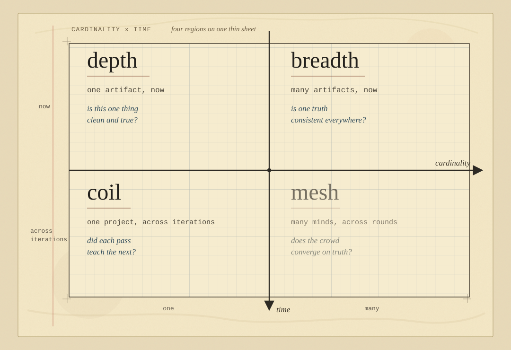

<div align="center">

# Paperthin: 低レベルの agent 設計パターン


再帰的な自己改善（**RSI**）のためのスキルブック。<br>**NVIDIA** の最新の証明を、時代に左右されないエンジニアリングで読み解きます。<br>**OpenAI** ハーネスエンジニアリング・ハッカソン優勝者の、キーに触れない手法から抽出しました。

**どの**agent でも | Codex, Claude Code, OpenCode, Cursor, Grok Build, Grok Bot, Muse, Pi, etc.

*"Best part is no part."* Elon Musk[^musk]

**[Bran Lee](https://github.com/LilMGenius) がつくっています**<br>2026: **OpenAI** ハーネスエンジニアリング・ハッカソン（Ralphthon Seoul #2、ソウルと SF で同時開催）*優勝*、大手テック企業と名門大学の博士チームの中で唯一のソロチーム<br>2026: **Claude Code** 公式ミートアップ招待スピーカー *2 回*<br>2026: **Google DeepMind** AI ハッカソン招待*審査員*<br>2014: 韓国情報オリンピアード（KOI）全国大会 *銀賞*<br>2009~: *9 歳*からコーディング

[クイックスタート](#quickstart-30-seconds) · [マップ](#the-map) · [インデックス](#the-index) · [問題](#the-problem) · [証明](#the-proof) · [クレジット](#credits)

<sub>Read in: [English](../../README.md) · [中文](./README.zh-CN.md) · [हिन्दी](./README.hi.md) · [Español](./README.es.md) · [العربية](./README.ar.md) · [Português](./README.pt.md) · [Русский](./README.ru.md) · 日本語 · [Français](./README.fr.md) · [Deutsch](./README.de.md) · [한국어](./README.ko.md)</sub>

</div>

---

<a id="quickstart-30-seconds"></a>
## クイックスタート（30秒）

**agent ごとに経路を一つ**だけ選んでください。二つ入れるとすべての skill が二重に読み込まれます。

1. **Codex**: セッション開始のたびに自動で更新されます。
   ```bash
   codex plugin marketplace add LilMGenius/paperthin && codex plugin add paperthin@paperthin
   ```
2. **Claude Code**:
   ```bash
   claude plugin marketplace add LilMGenius/paperthin && claude plugin install paperthin@paperthin
   ```
   その後 Claude Code で `/plugin` を実行して **Marketplaces** を開き、`paperthin` を選んで **Enable auto-update** を一度だけ有効にします。
3. **その他すべての agent**: 一行で skill と毎日の自動更新をまとめて入れます。
   ```bash
   npx skills@latest add LilMGenius/paperthin --global --agent '*' && node "$HOME/.agents/skills/re0-upgrade/scripts/schedule/schedule.mjs" install
   ```
4. **使ってみる**：`/paperthin` のあとに、あなたの夢を書くだけ。それで終わりです。仕組みを知りたくなったら、`/re0-tutorial` があります。
5. **お代は星で**：役に立ったら、お代は [GitHub のスター](https://github.com/LilMGenius/paperthin) ひとつ。安いものでしょう。

**以前に入れていたら？** 新しいセッションで `/re0-upgrade` を一度実行してください。

**迷ったら？** agent に [`install https://github.com/LilMGenius/paperthin`](../../.agents/install-block.md#handed-only-this-repository) と伝えてください。Web のチャットには [llms-full.txt](https://raw.githubusercontent.com/LilMGenius/paperthin/main/llms-full.txt) を渡します。

<a id="the-map"></a>
## マップ

**artifact はいくつあり、どれだけの時間にまたがるのか？**

<div align="center">

</div>

<a id="the-index"></a>
## インデックス

### `depth/`

| Skill | 何をするか | 呼び出し元 | 読み取り専用 |
|---|---|---|---|
| ♻️ **[re0](../../skills/depth/re0/SKILL.md)** | 継ぎはぎを重ねて散らかった文書やファイルを、さらに直すのではなく、きれいな最初の版として書き直します | モデル | |
| 🗜️ **[debloat](../../skills/depth/debloat/SKILL.md)** | 膨らんだ文章やコードを、必要な分だけに削ります。規則や動きは一つも失いません | モデル | |
| 🔃 **[re0-order](../../skills/depth/re0-order/SKILL.md)** | ばらばらになった一覧を、一つの決めごとに沿って並べ直します。項目を動かすだけで、言葉は変えません | モデル | |
| 🧰 **[detool](../../skills/depth/detool/SKILL.md)** | 長く残る文書にある製品名や道具の名前を、それが実際にしていることに置き換え、道具が変わっても文書が古びないようにします | モデル | |
| 🎨 **[re0-style](../../skills/depth/re0-style/SKILL.md)** | コードをプロジェクト独自の書き方にそろえて直し、プロジェクト自身が二通りに書いている所は質問します | モデル | |
| ✂️ **[dedash](../../skills/depth/dedash/SKILL.md)** | エージェントが文中にばらまく長いダッシュを取り除き、ハイフンや範囲、見出しの区切りは残します | ユーザー | |
| ⸱ **[dedot](../../skills/depth/dedot/SKILL.md)** | 韓国語の文章で列挙をつなぐ中黒ごとに、読点やつなぎの言葉を理由とともに提案します | ユーザー | ✔ |
| 🧭 **[readback](../../skills/depth/readback/SKILL.md)** | 作業の前に依頼を正しく理解できたか確かめ、解釈が本当に分かれるときだけ質問します | モデル | ✔ |
| 🏹 **[aim](../../skills/depth/aim/SKILL.md)** | 渡されたファイルや文章を読んで、望んでいそうなことを先に提案します。あなたは確認するだけです | モデル | ✔ |
| 📏 **[modelchk](../../skills/depth/modelchk/SKILL.md)** | 仕事をきちんとこなせる範囲で、いちばん安いモデルの等級と考える深さを選びます | モデル | ✔ |
| 🧹 **[elon](../../skills/depth/elon/SKILL.md)** | 習慣で残っているだけの要件や進行中の取り組みを、それぞれの出どころを添えて外すか先送りするよう提案します。外部で決められた規則には触れません | モデル | ✔ |
| 🧩 **[scopechk](../../skills/depth/scopechk/SKILL.md)** | 新しく加えたいものがその場所にふさわしいか、相手が自ら書いた範囲に照らして確かめ、合わなければよりよい置き場所を示します | モデル | ✔ |
| 😈 **[hate](../../skills/depth/hate/SKILL.md)** | あえて辛口の批評家になり、計画を沈めかねない反論を一つと、それを最も安く確かめる方法を返します | ユーザー | |
| 🧠 **[macrothink](../../skills/depth/macrothink/SKILL.md)** | あなたの前提を外した問いをいくつもの新しい視点に投げ、意見が割れたところから先に見せます | ユーザー | ✔ |
| 🔀 **[crossthink](../../skills/depth/crossthink/SKILL.md)** | どの選択肢も似たり寄ったりに見えるとき、無関係な分野五つ以上から実際に効く仕組みを借り、新しいものだけを残します | モデル | ✔ |
| ⚖️ **[re0-decide](../../skills/depth/re0-decide/SKILL.md)** | 決定のための資料をチェックリストに変え、結論はあなた自身の答えから出します。代わりに選ぶことはしません | ユーザー | ✔ |
| 🧐 **[whychk](../../skills/depth/whychk/SKILL.md)** | 下したばかりの決定を、あなたが説明できるまで問い詰め、できなければ論理の穴を指し示します | ユーザー | ✔ |
| 🛣️ **[autobahn](../../skills/depth/autobahn/SKILL.md)** | 作業の危ない部分を安全な代わりの案と一緒に先に切り分け、残りを全力で進め、外したものを記録します | モデル | |
| 🥄 **[sip](../../skills/depth/sip/SKILL.md)** | 何かを変えた直後、終わったと言う前に、paperthin 自身のチェックを成果物にかけます | モデル | |
| 🚿 **[shower](../../skills/depth/shower/SKILL.md)** | 経緯を何も知らない新しい読み手に成果物を渡し、それだけで意味が通じるか尋ねます | モデル | ✔ |
| 🔬 **[factchk](../../skills/depth/factchk/SKILL.md)** | 主張を実際の出典と両方向から照らし合わせます。ばかげた話が本当で、当たり前の話が誤りのこともあるからです | モデル | |
| 🧪 **[mandela](../../skills/depth/mandela/SKILL.md)** | テストや指標が自分で自分を採点していないか、外にある本当の事実が結果を決めているかを確かめます | モデル | ✔ |
| 🎭 **[demock](../../skills/depth/demock/SKILL.md)** | 動いているコードの中で、成功の報告を偽りにする偽物の実装や黙った代替経路を見つけ、本物の直し方を提案します | モデル | |
| 🥸 **[deid](../../skills/depth/deid/SKILL.md)** | 共有ファイルに紛れ込んだ一人の人や一社の情報を見つけて役割の名前に置き換え、まだそれを含む古いコミットを挙げます | モデル | |
| 🧾 **[re0-git](../../skills/depth/re0-git/SKILL.md)** | 済んだコミットのメッセージを日付と位置はそのままに書き直し、履歴だけで誰でも引き継げるようにします | ユーザー | |
| 🚀 **[re0-release](../../skills/depth/re0-release/SKILL.md)** | リリースのチェックリストを回し、あなたが確認したらタグを付けて公開します | ユーザー | |
| 🤝 **[re0-merge](../../skills/depth/re0-merge/SKILL.md)** | 他の人の貢献をレビューして取り込み、その人の功績を残し、手を入れた箇所はわけを説明します | ユーザー | |
| 🧨 **[re0-squash](../../skills/depth/re0-squash/SKILL.md)** | GitHub のリポジトリを、ファイルはそのままに署名付きのコミット一つとして公開し直し、古いコミットには二度と届かないようにします | ユーザー | |

### `breadth/`

| Skill | 何をするか | 呼び出し元 | 読み取り専用 |
|---|---|---|---|
| 🧲 **[ssotize](../../skills/breadth/ssotize/SKILL.md)** | あちこちに写された事実を見つけ、承認を得てから一か所にまとめ、残りはそこを指すようにします | モデル | |
| 🔗 **[ssotize-local](../../skills/breadth/ssotize-local/SKILL.md)** | 重複したファイルやフォルダを実体一つにまとめ、残りはそこへのリンクにします。元に戻す手順も確かめておきます | モデル | |
| 📖 **[re0-readme](../../skills/breadth/re0-readme/SKILL.md)** | README と AGENTS.md を見て、一行ごとに、それを必要とする読み手のファイルへ移します | モデル | |
| 📥 **[re0-import](../../skills/breadth/re0-import/SKILL.md)** | 渡された資料を、既存のナレッジベースのふさわしい文書へその規則どおりに収め、置き場のないものは知らせます | ユーザー | |
| 🆙 **[re0-upgrade](../../skills/breadth/re0-upgrade/SKILL.md)** | 確認一度で、インストールを最新の全カタログに揃えます。名前の変わったスキルは片づけ、新しいものは加えます | ユーザー | |

### `coil/`

| Skill | 何をするか | 呼び出し元 | 読み取り専用 |
|---|---|---|---|
| 🚪 **[paperthin](../../skills/coil/paperthin/SKILL.md)** | 覚えるのはこのコマンド一つだけ。あとに夢を書くだけです | ユーザー | |
| 🪜 **[re0-workflow](../../skills/coil/re0-workflow/SKILL.md)** | 一つの目標に向けて使うスキルと順番を選んで見せ、そのまま実行し、あなたの出番が来たところで止まります | モデル | |
| 📝 **[re0-memo](../../skills/coil/re0-memo/SKILL.md)** | 終わった、あるいは失敗したサイクルから、教訓と避けるべき失敗を引き出します | モデル | |
| 🔁 **[backprop](../../skills/coil/backprop/SKILL.md)** | 指摘から得た教訓を、その原因になった文書やルールに戻して直し、すっきり整えます | モデル | |
| 🧱 **[re0-work](../../skills/coil/re0-work/SKILL.md)** | 最初からやり直し、再利用する価値が確かめられた教訓だけを持ち越します | モデル | |
| 🗺️ **[catchup](../../skills/coil/catchup/SKILL.md)** | 離れていた間のことに追いつかせます。あなたの出番、変わったこと、新しい言葉の意味を伝えます | モデル | ✔ |
| 🎯 **[nba](../../skills/coil/nba/SKILL.md)** | 作業の現状を読み、選択肢の一覧ではなく、いちばんよい次の一手を一つだけ示します | モデル | ✔ |
| 🗂️ **[re0-plan](../../skills/coil/re0-plan/SKILL.md)** | 新しい作業サイクルを始める前に、設計、作業の流れ、証拠のファイルを入れたフォルダを用意します | ユーザー | |
| 🌀 **[re0-loop](../../skills/coil/re0-loop/SKILL.md)** | 作る、試す、学ぶ、やり直すのサイクルを回し続け、コードではなく教訓が積み上がるようにします | モデル | |
| 👁️ **[re0-watch](../../skills/coil/re0-watch/SKILL.md)** | 長いエージェント作業が止まっていないか見張って知らせます。立て直しはあなたが承認する提案にとどめます | ユーザー | |
| 🎓 **[re0-tutorial](../../skills/coil/re0-tutorial/SKILL.md)** | スキル一つを三段階で教え、各段階はあなた自身が出した成果物で合格になります | ユーザー | |

### `mesh/`

| Skill | 何をするか | 呼び出し元 | 読み取り専用 |
|---|---|---|---|
| 🕸️ **[multithink](../../skills/mesh/multithink/SKILL.md)** | いくつもの独立した意見を、賛成の数ではなく、挙げられた根拠で比べます | ユーザー | ✔ |

*呼び出しについて詳しくは [.agents/invocation.md](../../.agents/invocation.md) を参照。*

<a id="the-problem"></a>
## 問題

**ほとんどの agent skill は slop です。**

agent に目標を渡すと、agent は**足します**。ファイルを増やし、選択肢を増やし、「役に立つ」ボイラープレートを増やします。足すことは進捗に見え、何も戻って削除させません。

> [!WARNING]
> それをプロジェクト中で繰り返すと、見慣れた AI 生成ツールキットになります。ほぼ重複した skill、死んだ設定、同じことを三回言う markdown ファイル。もっともらしく、忙しそうで、静かに保守不能です。

これらの skill は逆に賭けます。**どれもが何かを取り除き**、何を取り除くかは[インデックス](#the-index)にあります。

> [!TIP]
> 難しいのは機能追加ではなく、抑制です。改善点を見つけない pass は何も変えません。**その抑制こそが製品です。**

<a id="the-proof"></a>
## 証明

**NVIDIA が測りました。長い履歴を捨てて短いメモで働くエージェントも、スコアを落としません。**

| NVIDIA が測ったもの | 長いコンテキスト | 短いメモ |
|---|---|---|
| SWE-bench Verified、Claude Opus 4.5 | 70.0 | 70.2 |
| 実行に必要だった最大コンテキスト | 200K トークン | 16K トークン |
| オープンウェイトの推論スループット、H100 | 256K ウィンドウ | 16K で最大 7 倍 |

<sub>Belcak ほか（NVIDIA）、[You don't need long context](https://arxiv.org/abs/2611.05306), arXiv 2611.05306, 2026-11-03。1 行目と 2 行目は表 2 で、Opus 4.5 が状態メモを持って一度にひとつずつ行動した結果です。3 行目は図 1 です（GLM 5.2 3.6 倍、Kimi K2.6 5.6 倍、Qwen 3 Coder Next 7 倍）。</sub>

**発見ごとに、Paperthin でそれを担うスキル：**

| 論文がわかったこと | 担うスキル |
|---|---|
| 長い作業に長いコンテキストはいらない。会話が埋まったらメモを書き、新しい会話で続ける | `re0-work` は検証済みの教訓だけを持って v0 からやり直し、`re0-git` は次のセッションへの引き継ぎを git の履歴に残します |
| よいメモはタスクを元の言葉に近いまま残す | `re0-loop` はセッションが圧縮されても新しく始まっても、未完了の依頼をすべてリストに残します |
| よいメモは、いまの作業、その理由、次の一手を残す | `re0-memo` は終わったサイクルを次のサイクルの関門に変え、`nba` は次の一手を決めます |
| よいメモは、計画、完了条件、資料の場所を残す | `re0-plan` は設計、手順、証拠ファイルでサイクルを開き、`re0-workflow` はスキルの順番を書き残します |
| 状態メモを持って一度にひとつずつ行動しても、スコアは全履歴を持つときと変わらない | `shower` は経緯を知らない読み手にメモだけを渡し、それだけで通じるかを尋ねます |
| ウィンドウが小さいほど、推論は最大 7 倍速い | `elon` は習慣だけで残ったものを外し、`debloat` は重みを支える部分だけを残し、`re0` は継ぎ足さずに書き直します |

<a id="credits"></a>
## クレジット

- **Built on** [mattpocock/skills](https://github.com/mattpocock/skills) (MIT) の architecture と philosophy。
- **fork ではありません** - これは [LilMGenius](https://github.com/LilMGenius) 独自の、重ならない workflows です。
- **Vendored verbatim** - いくつかの shared building blocks はそのまま保持し、 source ごとの attribution は [NOTICE](../../NOTICE) にあります。
- **Authoring guide** - conventions と philosophy は [AGENTS.md](../../AGENTS.md) にあります。

[^musk]: Elon Musk、[X での返信](https://x.com/elonmusk/status/2103537444910248312)、2026-09-25。SpaceX が V3 ブースターのグリッドフィンを 1 枚なくした件について @Erdayastronaut に返したもので、意味は「最良の部品は、部品がないこと」。エンジニアリングについての言葉で、Paperthin についての言葉ではありません。
